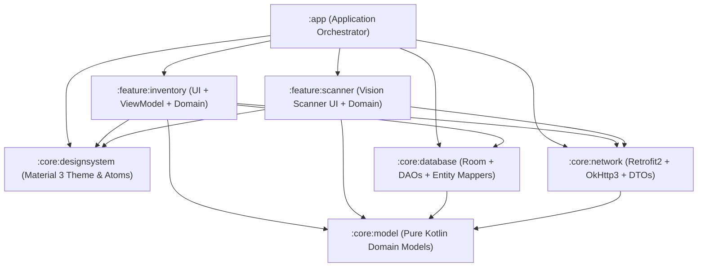
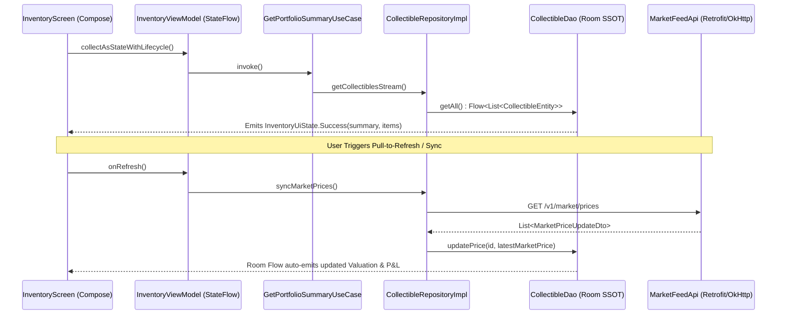

# VaultX — Smart Collectibles & Portfolio Tracker

[](.github/workflows/android_ci.yml)
[](https://kotlinlang.org)
[](https://developer.android.com/jetpack/compose)
[](#architecture--modularization)
[-EC4899)](https://dagger.dev/hilt/)

**VaultX** is an enterprise-grade Android architecture showcase designed to track graded trading cards (`PSA 10`, `BGS 9.5`), factory-sealed booster boxes, and slabbed comic books (`CGC 9.8`) with real-time portfolio valuation, cost-basis calculation, and Offline-First synchronization.

---

## Key Architectural Highlights

1. **Strict Multi-Module Clean Architecture**:
   - **`:core:model`** is a **100% pure Kotlin/JVM module** with zero Android SDK dependencies (`android.*`), guaranteeing fast JVM unit tests and strict domain isolation.
   - Feature modules (`:feature:inventory`, `:feature:scanner`) depend strictly downward on `:core:*` modules and never on sibling features.
2. **Offline-First Single Source of Truth (SSOT)**:
   - UI and Domain layers exclusively observe reactive `Flow<List<CollectibleItem>>` streams emitted by **Room (`CollectibleDao`)**.
   - Remote market price synchronization (`MarketFeedApi`) writes updates directly into Room, which automatically triggers downstream recomposition in `GetPortfolioSummaryUseCase` and `InventoryViewModel`.
3. **Unidirectional Data Flow (UDF) & Reactive State Management**:
   - `InventoryViewModel` combines multiple domain streams (`GetPortfolioSummaryUseCase`, `FilterCollectiblesUseCase`, search query, and refresh state) into a single lifecycle-aware `StateFlow<InventoryUiState>` using `SharingStarted.WhileSubscribed(5_000)`.
4. **Live Simulated Market Pricing Engine**:
   - Includes `SimulatedMarketFeedInterceptor` in `:core:network` so reviewers can pull-to-refresh or tap the sync button out-of-the-box without external API keys. Each sync executes the full **Retrofit2 -> OkHttp3 -> Kotlinx Serialization -> Room -> StateFlow** pipeline and simulates realistic market price movements.
5. **100% KSP & Modern Toolchain**:
   - Fully migrated from KAPT to **KSP2** for both **Room** and **Dagger-Hilt**.
   - Uses **Gradle Version Catalog (`libs.versions.toml`)** and `TYPESAFE_PROJECT_ACCESSORS`.

---

## Architecture & Modularization



### Unidirectional Data Flow (Offline-First Pipeline)



---

## Tech Stack

| Category | Technology |
| :--- | :--- |
| **Language & Concurrency** | Kotlin `2.1.20`, Coroutines & `StateFlow` |
| **UI Framework** | Jetpack Compose (BOM `2024.12.01`), Material 3, Pull-to-Refresh, Lifecycle-Aware Collection |
| **Dependency Injection** | Dagger-Hilt (`2.56.2`) via KSP |
| **Local Persistence** | Room (`2.7.1`) with exported JSON schemas & reactive `Flow` DAOs |
| **Networking & Serialization** | Retrofit `2.11.0`, OkHttp `4.12.0`, Kotlinx Serialization JSON |
| **Unit Testing** | JUnit 5 (Jupiter), MockK, CashApp Turbine, `kotlinx-coroutines-test` |
| **CI/CD & Code Quality** | GitHub Actions, Spotless + Ktlint, Android Lint, R8 Full Mode Minification |

---

## Getting Started & Running Tests

### 1. Run in Android Studio
1. Clone the repository and open the root folder in **Android Studio**.
2. Run the **`app`** configuration on any Android Emulator or physical device (`minSdk 26`).
3. Pull down on the portfolio list or tap the top-right **Sync** button to trigger live simulated market price updates.

### 2. Run JUnit 5 Unit Tests via CLI
```bash
./gradlew :core:model:test testDebugUnitTest
```

### 3. Run Code Style & Lint Checks
```bash
./gradlew spotlessCheck lintDebug
```

### 4. Assemble R8-Minified Release Bundle
```bash
./gradlew bundleRelease
```
